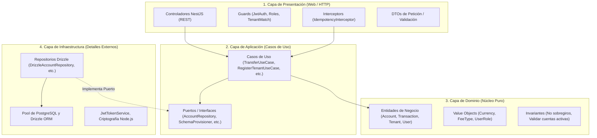
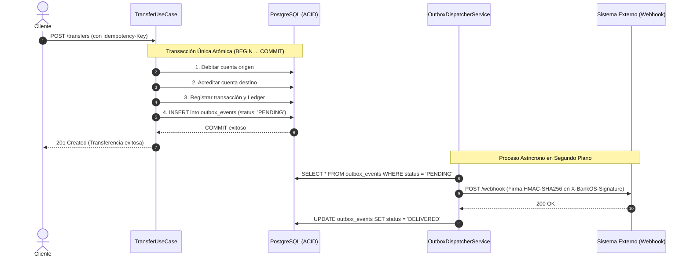

# Guía de Estudio Integral: BankOS Core Banking Backend

Bienvenido a la guía de estudio técnica de **BankOS**. Este documento está diseñado para que cualquier desarrollador, evaluador o arquitecto de software comprenda en profundidad cómo funciona el sistema, qué decisiones técnicas se tomaron, qué patrones de diseño se implementaron y cómo defenderlo con solvencia técnica en una sustentación o entrevista.

---

## 1. Visión General del Proyecto

### ¿Qué es BankOS?
**BankOS** es una plataforma de **Core Bancario Multitenant como Servicio (BaaS / SaaS)**. Permite que múltiples entidades financieras independientes (como "Banco de Bogotá", "Banco Santander", cooperativas o fintechs) operen de forma segura, aislada y personalizada sobre una infraestructura en la nube compartida.

### ¿Qué capacidades ofrece el sistema?
1. **Multitenancy estricto:** Aislamiento de datos por entidad bancaria a nivel de esquemas de base de datos (`tenant_<slug>`).
2. **Cuentas y Saldo Multimoneda:** Creación y manejo de cuentas en Pesos Colombianos (COP), Dólares Estadounidenses (USD) y Euros (EUR).
3. **Motor de Transacciones Financieras:**
   - Depósitos y retiros en cuenta corriente/ahorros.
   - Previsualización de transferencias con desglose de tasas y comisiones.
   - Transferencias atómicas entre cuentas de la misma moneda o entre monedas distintas con conversión cambiaria en tiempo real.
4. **Libro Contable de Doble Entrada (Ledger):** Cada movimiento de saldo genera asientos inmutables de débito y crédito.
5. **Idempotencia Robusta:** Prevención de transacciones duplicadas mediante la cabecera estándar `Idempotency-Key` (UUID v4) y hashing criptográfico SHA-256.
6. **Auditoría Inmutable (WORM):** Registro indeleble de acciones administrativas protegido por reglas a nivel de motor PostgreSQL que prohíben `UPDATE` y `DELETE`.
7. **Notificaciones Push y Webhooks:** Implementación del patrón **Transactional Outbox** con firmas de seguridad HMAC-SHA256 (`X-BankOS-Signature`).
8. **Seguridad Bancaria:** Autenticación JWT alineada a OIDC y control de acceso basado en roles (RBAC: `admin`, `compliance`, `customer`).

---

## 2. Stack Tecnológico y Justificaciones

| Tecnología | Rol en el Proyecto | ¿Por qué se eligió? |
| :--- | :--- | :--- |
| **Node.js (v20+) & TypeScript** | Entorno de ejecución y lenguaje | Tipado estático estricto (`strict: true`), prevención de errores en compilación y alta concurrencia asíncrona no bloqueante (I/O intensivo). |
| **NestJS 11** | Framework Backend | Arquitectura modular empresarial basada en Inversión de Control (IoC), Inyección de Dependencias (DI) y separación clara de responsabilidades. |
| **Drizzle ORM** | Capa de Acceso a Datos | ORM moderno, ligero y 100% tipado. No añade sobrecarga en tiempo de ejecución ("zero overhead"), genera SQL transparente y permite control exacto de transacciones ACID y esquemas dinámicos. |
| **PostgreSQL 16** | Base de Datos Relacional | Motor robusto con soporte nativo de transacciones ACID, aislamiento mediante esquemas independientes, tipos numéricos de alta precisión (`numeric`) y reglas de inmutabilidad en base de datos. |
| **Redis 7** | Almacenamiento en Memoria | Utilizado para almacenamiento ultrarrápido y expiración de claves de idempotencia y candados de concurrencia. |
| **Keycloak 24** | Identity Provider (IdP) OIDC | Servidor de identidad y gestión de acceso centralizado con soporte de estándares OAuth2 y OpenID Connect. |
| **Docker & Docker Compose** | Contenedorización | Garantiza reproducibilidad absoluta del entorno local (PostgreSQL, Redis, Keycloak) en un solo comando. |
| **Jest & Supertest** | Framework de Pruebas | Suite automatizada de pruebas unitarias y de integración end-to-end (E2E) con 89 tests pasando. |
| **Swagger / OpenAPI** | Documentación de API | Especificación viva y explorador interactivo disponible en `/api/docs`. |

---

## 3. Arquitectura Limpia (Clean Architecture)

BankOS adopta los principios de **Clean Architecture** (Arquitectura Limpia) y **Puertos y Adaptadores (Arquitectura Hexagonal)**. El principio fundamental es la **Regla de Dependencia**: el código fuente solo puede apuntar hacia adentro, hacia las políticas de mayor nivel (el dominio).



### Explicación de las 4 Capas:

1. **Capa de Dominio (`src/modules/*/domain/`):**
   - Es el núcleo puro del sistema. No tiene dependencias de NestJS, ni de Drizzle, ni de PostgreSQL.
   - **Entidades:** Por ejemplo, `Account` gestiona internamente sus saldos mediante métodos que protegen las reglas de negocio (`credit()`, `debit()`, `block()`, `deactivate()`). Si se intenta debitar más saldo del disponible, la propia entidad lanza una excepción de negocio.
   - **Value Objects:** Objetos inmutables como `Currency` ('COP', 'USD', 'EUR') o `FeeType` ('FIXED', 'PERCENTAGE').

2. **Capa de Aplicación (`src/modules/*/application/`):**
   - Orquesta la lógica del negocio.
   - **Casos de Uso (Use Cases):** Clases como `TransferUseCase`, `DepositUseCase` o `RegisterTenantUseCase`. Cada caso de uso representa una acción concreta del usuario.
   - **Puertos (Ports):** Interfaces que definen qué operaciones necesita la aplicación sin importar cómo se implementan (por ejemplo, `AccountRepository`, `LedgerRepository`, `SchemaProvisioner`).

3. **Capa de Infraestructura (`src/modules/*/infrastructure/`):**
   - Contiene los detalles técnicos y librerías externas.
   - **Adaptadores:** Clases como `DrizzleAccountRepository` o `PostgresSchemaProvisionerAdapter` que implementan los puertos definidos en la capa de aplicación.
   - Si en el futuro cambiamos PostgreSQL por CockroachDB o Drizzle por otra herramienta, **el dominio y la aplicación no sufren ninguna modificación**.

4. **Capa de Presentación (`src/modules/*/presentation/`):**
   - Expone la funcionalidad al mundo exterior (HTTP / REST).
   - Controladores de NestJS (`AccountsController`, `TransactionsController`, `TenantsController`), DTOs con decoradores de validación (`class-validator`), Interceptores y Guards.

---

## 4. Estrategia de Multitenancy: Esquemas Aislados

Una decisión clave en BankOS fue cómo aislar los datos entre diferentes bancos clientes.

### Comparación de Opciones de Multitenancy

| Modelo | Aislamiento | Rendimiento / Costo | Riesgo de Fuga de Datos |
| :--- | :--- | :--- | :--- |
| **Discriminador por Columna (`tenant_id`)** | Muy Débil | Muy barato | **Alto:** Un `WHERE` olvidado en una consulta SQL puede exponer cuentas de otro banco. |
| **Base de Datos por Tenant** | Máximo | Muy caro y difícil de escalar | Bajo, pero requiere gestionar cientos de conexiones independientes y migraciones pesadas. |
| **Esquema por Tenant (`tenant_<slug>`)** *(Elegido por BankOS)* | **Fuerte** | **Óptimo y Equilibrado** | **Prácticamente nulo:** Cada banco tiene su propio esquema de PostgreSQL delimitado lógicamente. |

### Cómo funciona en BankOS:
1. La tabla de registro maestro `tenants` vive en el esquema público (`public.tenants`).
2. Al registrar un nuevo banco (ej. `slug: "banco-bogota"`):
   - El caso de uso valida que el slug sea seguro.
   - El adaptador `PostgresSchemaProvisionerAdapter` ejecuta:
     ```sql
     CREATE SCHEMA IF NOT EXISTS "tenant_banco_bogota";
     ```
3. **Seguridad contra Inyección SQL:**
   El nombre del esquema se valida estrictamente mediante la expresión regular `^tenant_[a-z0-9_]{3,50}$` y se utiliza entrecomillado seguro de identificadores (`"${safeName}"`).

---

## 5. Manejo de Precisión Financiera (Drizzle & PostgreSQL)

En aplicaciones bancarias está terminantemente prohibido utilizar tipos de datos de coma flotante (`float`, `double` o `number` de JavaScript para cálculos directos) debido al error de redondeo del estándar binario IEEE 754 (donde `0.1 + 0.2 = 0.30000000000000004`).

### Solución en BankOS:
- En la base de datos PostgreSQL y en Drizzle ORM se usa **`numeric(18, 2)`** para importes monetarios (18 dígitos en total, exactamente 2 decimales para centavos) y **`numeric(18, 6)`** para tasas de cambio (hasta 6 decimales de precisión cambiaria).
- En el código TypeScript, los montos se transportan como cadenas de texto (`string`) en los DTOs y se procesan mediante operaciones de precisión fija con redondeo explícito (`toFixed(2)` y `toFixed(6)`).

---

## 6. Patrones Bancarios de Nivel Corporativo

### A. Libro Contable de Doble Entrada (Ledger)
En un banco real, el saldo de una cuenta nunca cambia "por arte de magia" mediante un simple `UPDATE accounts SET balance = balance + 100`. Cada centavo que entra o sale debe tener una justificación contable inmutable:
- **Asiento de Débito (`DEBIT`):** Disminución de saldo (retiro o salida por transferencia).
- **Asiento de Crédito (`CREDIT`):** Aumento de saldo (depósito o llegada de transferencia).
- Cada transacción exitosa crea simultáneamente un registro en `transactions` y sus correspondientes asientos en `ledger_entries`.

### B. Idempotencia Distribuida (IETF Draft)
En redes móviles o conexiones inestables, un cliente puede enviar una orden de transferencia, la red falla antes de recibir la confirmación y el cliente presiona "Reintentar". Sin idempotencia, ¡el banco debitaría dos veces el dinero!

**Implementación en BankOS (`HU-10`):**
1. El cliente envía la cabecera obligatoria `Idempotency-Key: <UUID-v4>`.
2. El interceptor `IdempotencyInterceptor` calcula el hash SHA-256 del cuerpo de la petición (`request.body`), método y URL.
3. Se verifica si la clave ya fue procesada:
   - **Si es nueva:** Adquiere un candado (`IN_PROGRESS`), procesa la transacción y guarda la respuesta HTTP en base de datos/caché por 24 horas.
   - **Si es repetida con el mismo payload:** Retorna inmediatamente la respuesta HTTP original sin reejecutar la lógica financiera.
   - **Si se reutiliza con un payload distinto:** Arroja un error `409 Conflict` por inconsistencia de idempotencia.

### C. Transactional Outbox Pattern (Webhooks Confiables)
Cuando una transacción financiera finaliza, es necesario notificar a sistemas externos (core legado, aplicaciones móviles, sistemas antifraude) mediante Webhooks.

**El Problema de la Escritura Doble (Dual-Write Problem):**
Si el backend actualiza la base de datos y luego llama por HTTP al webhook externo, ¿qué pasa si el servidor externo está caído o la red falla? La transacción ya ocurrió, pero el evento se perdió.



### D. Auditoría Inmutable (WORM - Write Once, Read Many)
Para cumplir con normativas de entidades regulatorias (Superintendencia Financiera, Basel III, SOX), las acciones administrativas (cambiar tasas, editar límites, congelar usuarios) no pueden ser borradas ni alteradas, ni siquiera por el administrador de base de datos.

En `src/database/seeds/demo-seed.ts` e infraestructura, la tabla `audit_logs` cuenta con **Reglas nativas de PostgreSQL**:
```sql
CREATE OR REPLACE RULE audit_logs_no_update AS ON UPDATE TO public.audit_logs DO INSTEAD NOTHING;
CREATE OR REPLACE RULE audit_logs_no_delete AS ON DELETE TO public.audit_logs DO INSTEAD NOTHING;
```
Cualquier intento de ejecutar `UPDATE` o `DELETE` sobre la tabla de auditoría es neutralizado directamente por el motor de PostgreSQL.

---

## 7. Recorrido por las Historias de Usuario (85 Story Points)

| Código | Título | Puntos | Descripción y Funcionalidad |
| :--- | :--- | :---: | :--- |
| **HU-00** | Entorno y Clean Architecture | 5 SP | Configuración base, TypeScript estricto, Docker Compose, Swagger en `/api/docs`. |
| **HU-01** | Registrar Tenant Bancario | 5 SP | Registro de bancos, validación de slugs y aprovisionamiento automático de esquemas PostgreSQL (`tenant_<slug>`). |
| **HU-02** | Reglas Financieras y Tasas | 5 SP | Configuración de moneda principal, monto máximo por operación, tipo de comisión (`FIXED` o `PERCENTAGE`) y tasas de cambio multimoneda. |
| **HU-03** | Autenticación OIDC y RBAC | 8 SP | Emisión y validación de tokens JWT con claims bancarios (`tenant_id`, `role`, `user_id`). Guards `JwtAuthGuard`, `RolesGuard` y `TenantMatchGuard`. |
| **HU-04** | Administrar Usuarios y Clientes | 5 SP | Registro de usuarios y clientes asociados a un tenant con validación de documentos y correos electrónicos. |
| **HU-05** | Crear y Administrar Cuentas | 5 SP | Apertura de cuentas bancarias en COP/USD, congelamiento temporal (`block()`) y desactivación (Soft Delete). |
| **HU-07** | Realizar Depósitos | 5 SP | Caso de uso `DepositUseCase`. Abono atómico de fondos, verificación de cuenta activa y registro de asiento `CREDIT` en el Ledger. |
| **HU-08** | Realizar Retiros | 5 SP | Caso de uso `WithdrawUseCase`. Validación estricta de saldo suficiente (prevención de sobregiros) y registro de asiento `DEBIT` en Ledger. |
| **HU-09** | Transferencias Multimoneda | 13 SP | `PreviewTransferUseCase` (simulación sin mutar saldos) y `TransferUseCase` (débito, crédito, cálculo de comisión y conversión de divisas en transacción atómica). |
| **HU-10** | Idempotencia y Trazabilidad | 8 SP | `CorrelationIdMiddleware` (`X-Correlation-ID`) e `IdempotencyInterceptor` (`Idempotency-Key` UUID v4 con validez de 24 horas y hash SHA-256). |
| **HU-11** | Historial y Detalle de Transacciones | 5 SP | Consulta paginada de movimientos bancarios con filtros por tipo, fechas y banderas `hasFee` y `hasConversion`. |
| **HU-14** | Auditar Acciones Administrativas | 5 SP | Módulo de auditoría WORM que guarda el estado previo y nuevo de cada cambio administrativo con trazabilidad de correlación. |
| **HU-15** | Webhooks y Transactional Outbox | 8 SP | Registro de endpoints receptores, almacenamiento de eventos en `outbox_events` y despachador seguro con firmas criptográficas HMAC-SHA256. |
| **HU-16** | Docker, Seed y Demostración | 8 SP | Script `npm run seed` con datos realistas listos para evaluación, colección oficial de Postman y README integral. |

---

## 8. Guía de Ejecución y Pruebas Prácticas

### Paso 1: Levantar los Servicios en Docker
Asegúrate de tener Docker Desktop abierto y ejecuta en la terminal:
```powershell
docker compose up postgres redis keycloak -d
```
Verifica que los tres contenedores estén en estado *Up*:
```powershell
docker compose ps
```

### Paso 2: Ejecutar el Seed de Datos de Demostración
Pobla la base de datos con instituciones (Banco de Bogotá, Banco Santander), configuraciones, tasas de cambio, clientes y cuentas de prueba:
```powershell
npm run seed
```

### Paso 3: Iniciar el Servidor de BankOS
```powershell
npm run start:dev
```
El servidor quedará escuchando en `http://localhost:3000`.

### Paso 4: Explorar Swagger UI
Abre tu navegador en:
```
http://localhost:3000/api/docs
```

#### Flujo de Prueba Recomendado en Swagger:
1. **Generar Token JWT:**
   - Ve a `POST /api/v1/identity/token`.
   - Haz clic en **Try it out** y envía este cuerpo para el cliente Carlos de Banco de Bogotá:
     ```json
     {
       "tenantSlug": "banco-bogota",
       "tenantId": "11111111-1111-4111-8111-111111111111",
       "userId": "55555555-5555-4555-8555-555555555555",
       "role": "customer",
       "email": "carlos@bogota.com"
     }
     ```
   - Copia el campo `token` devuelto.
2. **Autorizar en Swagger:**
   - Sube al inicio de Swagger y presiona el botón verde **Authorize** (candado).
   - En la sección **bearer (http, Bearer)**, pega el token y haz clic en **Authorize**.
   - En la sección **Idempotency-Key**, coloca un UUID (ej. `e2b86d9b-76bb-49e2-b13c-7a91c107293a`).
   - Haz clic en **Close**.
3. **Probar una Previsualización de Transferencia:**
   - Ve a `POST /api/v1/tenants/banco-bogota/transactions/transfer-preview`.
   - Consulta el desglose para transferir desde la cuenta en COP a la de USD:
     ```json
     {
       "sourceAccountNumber": "CTA-COP-001",
       "destinationAccountNumber": "CTA-USD-002",
       "targetAmount": "100.00"
     }
     ```
   - Verás el cálculo de la tasa de cambio aplicada, el total a debitar y la comisión sin haber alterado ningún saldo.
4. **Ejecutar la Transferencia Real:**
   - Ve a `POST /api/v1/tenants/banco-bogota/transactions/transfer`.
   - Envía el mismo payload y confirma el resultado con estado `201 Created`.
5. **Comprobar la Idempotencia:**
   - Vuelve a presionar **Execute** sin cambiar el `Idempotency-Key`.
   - Notarás que el servidor devuelve instantáneamente el mismo resultado y no debita doblemente la cuenta.

---

## 9. Preguntas Frecuentes para Entrevistas y Sustentaciones

### P1: ¿Por qué no usamos un ORM tradicional como TypeORM o Prisma?
> **Respuesta:** En sistemas bancarios de misión crítica, la transparencia sobre el SQL generado es vital. TypeORM suele presentar problemas de rendimiento con consultas N+1 y sobrecarga de estado en memoria. Drizzle ORM ofrece una experiencia puramente funcional y fuertemente tipada con TypeScript, garantizando que el desarrollador tenga control total de las sentencias SQL y las transacciones ACID con cero sobrecarga en tiempo de ejecución.

### P2: ¿Qué sucede si dos clientes intentan transferir al mismo tiempo desde la misma cuenta?
> **Respuesta:** Se implementa un candado pesimista y control de concurrencia atómico dentro de una transacción PostgreSQL (`BEGIN ... COMMIT`). Si una cuenta no tiene fondos suficientes en el momento exacto en que la transacción bloquea la fila para actualización, la segunda operación es rechazada con un error `400 Bad Request: Saldo insuficiente`.

### P3: ¿Cómo se garantiza que un evento de Webhook no se pierda si el servidor se apaga repentinamente?
> **Respuesta:** Gracias al patrón **Transactional Outbox**. El registro de la transacción financiera y la inserción del evento en la tabla `outbox_events` ocurren dentro de la **misma transacción atómica de base de datos**. Si la base de datos confirma el débito, el evento está garantizado de estar guardado con estado `PENDING`. Un despachador en segundo plano lo lee y reintenta su envío hasta obtener confirmación HTTP 200.

### P4: ¿Por qué la tabla de auditoría tiene reglas en PostgreSQL y no solo validaciones en NestJS?
> **Respuesta:** Principio de **Defensa en Profundidad**. Si un atacante o un desarrollador malintencionado obtiene acceso directo a la consola de base de datos (`psql`) con permisos de superusuario e intenta hacer `DELETE FROM audit_logs`, la regla nativa `audit_logs_no_delete` intercepta la orden a nivel del motor y no realiza ninguna acción (`DO INSTEAD NOTHING`), preservando la inmutabilidad de la bitácora legal.
