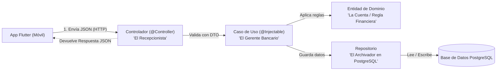
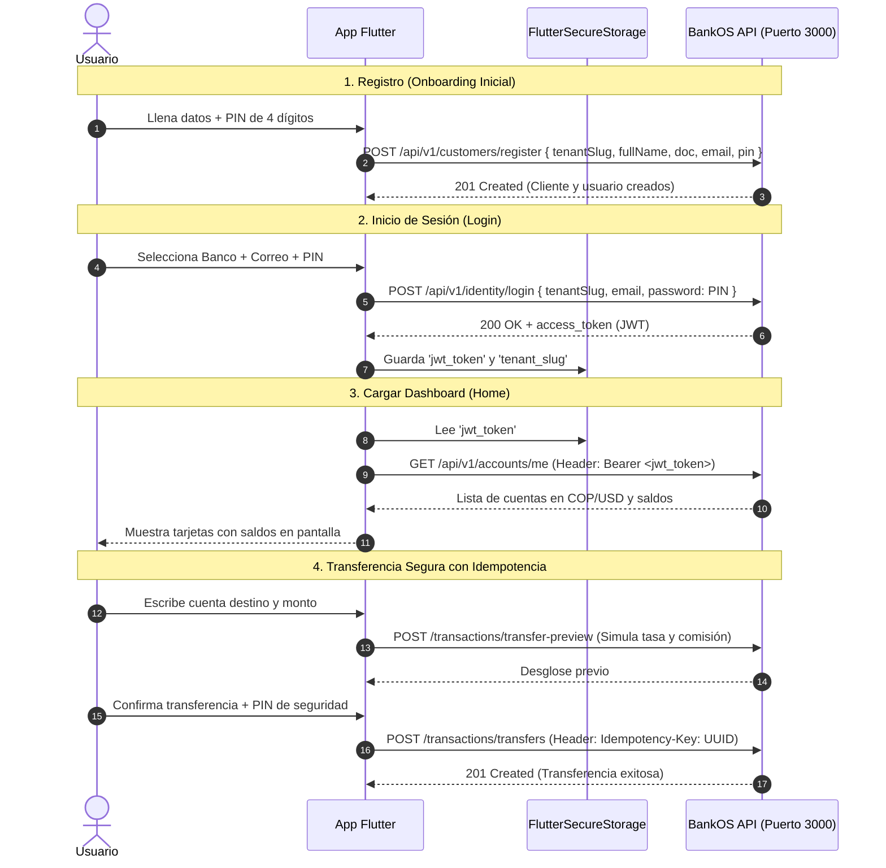

# Manual Integral de BankOS Backend: Guía Práctica para Desarrolladores Frontend y Móviles

> **Destinatarios:** Equipo de desarrollo frontend (Flutter / Web) o evaluadores que no tienen experiencia previa en NestJS o arquitectura de backend.  
> **Objetivo:** Explicar con lenguaje claro, pedagógico y directo qué hace cada carpeta del proyecto, cómo funciona la arquitectura de NestJS, y detallar con ejemplos reales **cada uno de los endpoints** (qué reciben, qué devuelven, qué errores arrojan y cómo conectarlos desde Flutter).

---

## Tabla de Contenido
1. [¿Qué es un Backend y qué es NestJS? (Explicado para no-backend)](#1-qué-es-un-backend-y-qué-es-nestjs-explicado-para-no-backend)
2. [Estructura del Proyecto: ¿Qué hace cada carpeta?](#2-estructura-del-proyecto-qué-hace-cada-carpeta)
3. [Las 4 Capas de Clean Architecture dentro de cada Módulo](#3-las-4-capas-de-clean-architecture-dentro-de-cada-módulo)
4. [Conceptos Clave de Seguridad y Red para Flutter](#4-conceptos-clave-de-seguridad-y-red-para-flutter)
5. [Catálogo Completo de Endpoints (Manual de Referencia)](#5-catálogo-completo-de-endpoints-manual-de-referencia)
   - [A. Endpoints de Instituciones Bancarias (Tenants)](#a-endpoints-de-instituciones-bancarias-tenants)
   - [B. Endpoints de Configuración y Tasas de Cambio](#b-endpoints-de-configuración-y-tasas-de-cambio)
   - [C. Endpoints de Autenticación y Login (Identidad)](#c-endpoints-de-autenticación-y-login-identidad)
   - [D. Endpoints de Clientes (Onboarding y Perfil)](#d-endpoints-de-clientes-onboarding-y-perfil)
   - [E. Endpoints de Cuentas Bancarias](#e-endpoints-de-cuentas-bancarias)
   - [F. Endpoints de Operaciones Financieras (Depósitos, Retiros, Transferencias)](#f-endpoints-de-operaciones-financieras-depósitos-retiros-transferencias)
   - [G. Endpoints de Auditoría Legal y Webhooks](#g-endpoints-de-auditoría-legal-y-webhooks)
6. [Guía Paso a Paso para Conectar Flutter con BankOS](#6-guía-paso-a-paso-para-conectar-flutter-con-bankos)
7. [Glosario de Términos](#7-glosario-de-términos)

---

## 1. ¿Qué es un Backend y qué es NestJS? (Explicado para no-backend)

Si vienes de Flutter o diseño UI, piensa en el sistema como un **restaurante**:
- **Flutter (Frontend / App Móvil):** Es el **menú visual y el comedor**. Es lo que el cliente ve, toca, donde escribe su PIN y donde ve su saldo.
- **Backend (BankOS / NestJS):** Es la **cocina, la caja fuerte y el libro de contabilidad**. Aquí no hay pantallas. Su trabajo es recibir órdenes por internet (peticiones HTTP), verificar que el cliente tenga fondos suficientes, calcular comisiones, convertir monedas y guardar todo de forma segura para que nadie pueda robar ni alterar registros.

### ¿Qué es NestJS?
**NestJS** es un framework de Node.js (escrito en TypeScript) que organiza el backend en piezas ordenadas e intercambiables, usando 5 conceptos fundamentales:



1. **Controlador (`@Controller`):** Es el *recepcionista*. Escucha las URLs (ej. `/identity/login`). Recibe lo que manda Flutter, llama a quien sabe hacer el trabajo y devuelve la respuesta en JSON.
2. **DTO (Data Transfer Object):** Es el *formulario de entrada*. Define exactamente qué campos debe mandar Flutter (ej. `email`, `password`) y valida automáticamente que el correo tenga `@` o que el PIN tenga exactamente 4 dígitos.
3. **Caso de Uso / Servicio (`@Injectable`):** Es el *cajero o gerente*. Contiene la lógica del negocio: verifica si hay saldo suficiente, calcula la tasa de cambio y coordina la operación.
4. **Entidad de Dominio:** Es el *objeto bancario real* (una `Account`, un `User`, un `Tenant`). Protege sus propios datos (ej. no permite que un saldo quede negativo).
5. **Repositorio:** Es el *archivador*. Se encarga de guardar y leer la información en la base de datos PostgreSQL mediante sentencias SQL tipadas con Drizzle ORM.

---

## 2. Estructura del Proyecto: ¿Qué hace cada carpeta?

Cuando abres la carpeta `BankOS_Backend`, te encuentras con la siguiente distribución:

```text
BankOS_Backend/
├── src/                          <-- TODO EL CÓDIGO FUENTE DE LA APLICACIÓN
│   ├── main.ts                   <-- El interruptor principal: prende el servidor en el puerto 3000
│   ├── app.module.ts             <-- El director de orquesta: conecta todos los módulos entre sí
│   ├── app.controller.ts         <-- Endpoint raíz: responde si el servidor está vivo (Health check)
│   │
│   ├── common/                   <-- UTILIDADES COMPARTIDAS POR TODO EL SISTEMA
│   │   ├── filters/              <-- Atrapa errores (400, 404, 500) y les da formato uniforme
│   │   ├── guards/               <-- Controladores de tráfico: Rate Limiting (evita ataques DoS)
│   │   └── middleware/           <-- Asigna a cada petición un código único (X-Correlation-ID)
│   │
│   ├── database/                 <-- CONEXIÓN Y MODELOS DE BASE DE DATOS
│   │   ├── database.module.ts    <-- Conecta el pool de PostgreSQL y Drizzle ORM
│   │   ├── schema/               <-- Tablas de PostgreSQL: users, customers, accounts, transactions...
│   │   └── seeds/                <-- demo-seed.ts: datos de prueba listos (Bogotá, Santander, saldos)
│   │
│   └── modules/                  <-- LOS 9 DEPARTAMENTOS DE LA PLATAFORMA
│       ├── tenants/              <-- Gestión de Bancos (creación, esquema propio, comisiones, tasas)
│       ├── identity/             <-- Seguridad: Login con PIN de 4 dígitos, JWT, roles Admin/Customer
│       ├── customers/            <-- Clientes: Ficha del usuario (nombre, cédula, teléfono, correo)
│       ├── accounts/             <-- Cuentas bancarias: Apertura, saldos en COP/USD, congelamiento
│       ├── transactions/         <-- Movimientos: Depósitos, retiros y transferencias multimoneda
│       ├── ledger/               <-- Libro Mayor: Registro contable estricto de débito y crédito
│       ├── idempotency/          <-- Escudo contra cobros dobles por caídas de internet (Idempotency-Key)
│       ├── audit/                <-- Bitácora legal inmutable que nadie puede borrar (WORM)
│       └── webhooks/             <-- Notificaciones automáticas a sistemas externos con firmas HMAC
│
├── test/                         <-- Pruebas End-to-End (E2E) que simulan peticiones reales
├── docs/                         <-- Documentación y guías técnicas de estudio
├── docker-compose.yml            <-- Levanta PostgreSQL, Redis y Keycloak en un solo comando
├── Dockerfile                    <-- Empaqueta el backend listo para desplegar en la nube
└── package.json                  <-- Dependencias y scripts del proyecto (npm run build, test, lint)
```

---

## 3. Las 4 Capas de Clean Architecture dentro de cada Módulo

Dentro de cada módulo (por ejemplo en `src/modules/accounts/` o `src/modules/transactions/`), verás siempre estas 4 subcarpetas ordenadas de afuera hacia adentro:

1. **`presentation/` (Capa Externa - Entrada HTTP):**
   - **Controllers:** Reciben la petición HTTP desde Flutter.
   - **DTOs:** Validan los datos recibidos (ej. qué campos son obligatorios).
2. **`application/` (Capa de Casos de Uso):**
   - Contiene los flujos de negocio (ej. `CreateAccountUseCase`, `TransferUseCase`).
   - Define los **Puertos (Interfaces)**: Contratos que dicen *"necesito guardar una cuenta"*, sin importar qué base de datos se use.
3. **`domain/` (Capa Central - Reglas Puras):**
   - Las entidades bancarias (`Account`, `Customer`, `Tenant`).
   - No usan ninguna librería externa. Contienen reglas como: *"no se puede retirar más del saldo disponible"* o *"el número de cuenta debe tener al menos 6 dígitos"*.
4. **`infrastructure/` (Capa de Adaptadores Técnicos):**
   - La implementación real que habla con PostgreSQL (`DrizzleAccountRepository`), Redis o servicios criptográficos (`PasswordHasher`).

---

## 4. Conceptos Clave de Seguridad y Red para Flutter

### A. ¿A qué dirección IP debe llamar Flutter?
- **Si usas el Emulador de Android:**  
  Tu computadora es `http://10.0.2.2:3000/api/v1` (en Android, `localhost` apunta al mismo emulador, no a tu PC).
- **Si usas el Simulador de iOS:**  
  Usa `http://localhost:3000/api/v1`.
- **Si pruebas en un Celular Físico (conectado por Wi-Fi):**  
  Usa la IP local de tu computador en la red (ej. `http://192.168.1.15:3000/api/v1`).

---

### B. Encabezados HTTP (Headers) que debes enviar

| Header | ¿Cuándo se envía? | ¿Qué contiene? | Ejemplo |
| :--- | :--- | :--- | :--- |
| **`Content-Type`** | En todos los `POST`, `PUT`, `PATCH` | Indica formato JSON | `application/json` |
| **`Authorization`** | En endpoints protegidos (después del login) | El token JWT obtenido en el login | `Bearer eyJhbGciOi...` |
| **`Idempotency-Key`** | **Obligatorio en transferencias, retiros y depósitos** | Un UUID v4 generado aleatoriamente en Flutter antes de enviar | `e2b86d9b-76bb-49e2-b13c-7a91c107293a` |
| **`X-Correlation-ID`** | Opcional (si no lo mandas, el backend lo genera) | UUID para rastrear la petición en los logs | `a8d388b4-804c-470b-8f80-76dc3b9e1cd9` |

---

### C. El Escudo de Idempotencia (`Idempotency-Key`)
**¿Por qué es obligatorio en operaciones financieras?**  
Imagina que el usuario está transfiriendo $100.000 COP y presiona el botón "Transferir". Justo en ese segundo, el celular pierde la señal por 2 segundos. La app no sabe si la plata salió o no. Si el usuario vuelve a presionar "Transferir", sin idempotencia le cobraría $200.000 COP (doble cobro).  
Con la cabecera `Idempotency-Key: <UUID>`, el backend reconoce que es la misma transacción, devuelve el resultado exitoso original y **no descuenta dinero dos veces**.

---

## 5. Catálogo Completo de Endpoints (Manual de Referencia)

Todos los endpoints tienen el prefijo global: **`/api/v1`**.

---

### A. Endpoints de Instituciones Bancarias (Tenants)

#### 1. Listar Bancos Disponibles (Público - Ideal para Dropdown en Flutter)
- **Método:** `GET`
- **URL:** `/api/v1/tenants`
- **Requiere Token:** No.
- **¿Para qué sirve?:** Para que en la pantalla de registro o de login en Flutter cargues la lista desplegable de bancos.
- **Respuesta Exitosa (`200 OK`):**
  ```json
  [
    {
      "id": "11111111-1111-4111-8111-111111111111",
      "name": "Banco de Bogotá",
      "slug": "banco-bogota",
      "status": "ACTIVE",
      "schemaName": "tenant_banco_bogota",
      "primaryCurrency": "COP",
      "maxTransactionAmount": "50000000.00",
      "feeType": "FIXED",
      "feeValue": "2500.0000",
      "createdAt": "2026-11-18T08:00:00.000Z",
      "updatedAt": "2026-11-18T08:00:00.000Z"
    },
    {
      "id": "22222222-2222-4222-8222-222222222222",
      "name": "Banco Santander",
      "slug": "banco-santander",
      "status": "ACTIVE",
      "schemaName": "tenant_banco_santander",
      "primaryCurrency": "USD",
      "maxTransactionAmount": "10000.00",
      "feeType": "PERCENTAGE",
      "feeValue": "1.5000",
      "createdAt": "2026-11-18T08:00:00.000Z",
      "updatedAt": "2026-11-18T08:00:00.000Z"
    }
  ]
  ```

#### 2. Registrar un Nuevo Banco (Tenant)
- **Método:** `POST`
- **URL:** `/api/v1/tenants`
- **Requiere Token:** No.
- **Qué recibe en el Body (JSON):**
  ```json
  {
    "name": "Banco Davivienda",
    "slug": "banco-davivienda",
    "primaryCurrency": "COP",
    "maxTransactionAmount": "50000000.00",
    "feeType": "FIXED",
    "feeValue": "2500.00"
  }
  ```
- **Respuesta Exitosa (`201 Created`):** Devuelve el objeto del banco con estado `ACTIVE` tras haber creado automáticamente su esquema físico PostgreSQL `tenant_banco_davivienda` con sus 11 tablas independientes y sus parámetros financieros inicializados.

---

### B. Endpoints de Configuración y Tasas de Cambio

#### 3. Consultar Reglas Financieras de un Banco
- **Método:** `GET`
- **URL:** `/api/v1/tenants/:slug/settings`  *(Ej: `/api/v1/tenants/banco-bogota/settings`)*
- **Requiere Token:** Sí (Admin o Customer).
- **Respuesta Exitosa (`200 OK`):**
  ```json
  {
    "tenantId": "11111111-1111-4111-8111-111111111111",
    "primaryCurrency": "COP",
    "maxTransactionAmount": "50000000.00",
    "feeType": "FIXED",
    "feeValue": "2500.00"
  }
  ```

#### 4. Consultar Tasas de Cambio de Divisas
- **Método:** `GET`
- **URL:** `/api/v1/tenants/:slug/exchange-rates`
- **Requiere Token:** Sí.
- **Respuesta Exitosa (`200 OK`):**
  ```json
  [
    {
      "fromCurrency": "USD",
      "toCurrency": "COP",
      "rate": "4000.000000"
    },
    {
      "fromCurrency": "EUR",
      "toCurrency": "COP",
      "rate": "4300.000000"
    }
  ]
  ```

---

### C. Endpoints de Autenticación y Login (Identidad)

#### 5. Iniciar Sesión en la App Móvil (Login con PIN)
- **Método:** `POST`
- **URL:** `/api/v1/identity/login`
- **Requiere Token:** No (Ruta pública con protección de Rate Limit: máx 10 intentos/minuto por IP).
- **Qué recibe en el Body (JSON):**
  ```json
  {
    "tenantSlug": "banco-bogota",
    "email": "carlos@bogota.com",
    "password": "1234"
  }
  ```
  *(Nota: Puedes enviar `"pin": "1234"` o `"password": "1234"`. El PIN debe tener exactamente 4 dígitos).*
- **Respuesta Exitosa (`200 OK`):**
  ```json
  {
    "access_token": "eyJhbGciOiJIUzI1NiIsInR5cCI6IkpXVCJ9.ey...",
    "token_type": "Bearer",
    "expires_in": 3600,
    "user": {
      "userId": "55555555-5555-4555-8555-555555555555",
      "tenantId": "11111111-1111-4111-8111-111111111111",
      "tenantSlug": "banco-bogota",
      "tenantName": "Banco de Bogotá",
      "email": "carlos@bogota.com",
      "role": "customer"
    }
  }
  ```
- **Posibles Errores:**
  - `400 Bad Request`: Si falta el `tenantSlug` o el PIN no tiene 4 dígitos.
  - `401 Unauthorized`: Si el PIN es incorrecto o el usuario no existe en ese banco.
  - `403 Forbidden`: Si el usuario está bloqueado por seguridad.
  - `404 Not Found`: Si el banco (`tenantSlug`) no existe.

---

### D. Endpoints de Clientes (Onboarding y Perfil)

#### 6. Auto-Registro / Onboarding de Cliente desde Flutter
- **Método:** `POST`
- **URL:** `/api/v1/customers/register` *(o `/api/v1/tenants/banco-bogota/customers/register`)*
- **Requiere Token:** No (Ruta pública).
- **Qué recibe en el Body (JSON):**
  ```json
  {
    "tenantSlug": "banco-bogota",
    "fullName": "Carlos Gómez",
    "documentNumber": "1020304050",
    "email": "carlos@bogota.com",
    "phone": "+573001234567",
    "pin": "1234"
  }
  ```
- **Respuesta Exitosa (`201 Created`):**
  ```json
  {
    "id": "c1a2b3c4-1111-2222-3333-444455556666",
    "userId": "55555555-5555-4555-8555-555555555555",
    "tenantId": "11111111-1111-4111-8111-111111111111",
    "fullName": "Carlos Gómez",
    "documentNumber": "1020304050",
    "email": "carlos@bogota.com",
    "phone": "+573001234567",
    "createdAt": "2026-11-18T08:00:00.000Z"
  }
  ```
- **Posibles Errores:**
  - `409 Conflict`: Si el documento o correo ya está registrado en ese banco.

#### 7. Consultar Perfil del Cliente Autenticado
- **Método:** `GET`
- **URL:** `/api/v1/customers/me`
- **Requiere Token:** Sí (`Authorization: Bearer <token>`).
- **Respuesta Exitosa (`200 OK`):** Devuelve la ficha completa del cliente conectado.

---

### E. Endpoints de Cuentas Bancarias

#### 8. Consultar Mis Cuentas Bancarias (Dashboard Home de Flutter)
- **Método:** `GET`
- **URL:** `/api/v1/accounts/me` *(o `/api/v1/tenants/banco-bogota/accounts/me`)*
- **Requiere Token:** Sí (`Authorization: Bearer <token>`).
- **¿Para qué sirve?:** Al abrir la app tras el login, Flutter llama a este endpoint para pintar las tarjetas de cuentas con sus saldos.
- **Respuesta Exitosa (`200 OK`):**
  ```json
  [
    {
      "id": "88888888-8888-4888-8888-888888888881",
      "tenantId": "11111111-1111-4111-8111-111111111111",
      "customerId": "55555555-5555-4555-8555-555555555555",
      "accountNumber": "1001001001",
      "currency": "COP",
      "balance": "5000000.00",
      "status": "ACTIVE",
      "createdAt": "2026-11-18T08:00:00.000Z"
    },
    {
      "id": "88888888-8888-4888-8888-888888888882",
      "tenantId": "11111111-1111-4111-8111-111111111111",
      "customerId": "55555555-5555-4555-8555-555555555555",
      "accountNumber": "1001001002",
      "currency": "USD",
      "balance": "1500.00",
      "status": "ACTIVE",
      "createdAt": "2026-11-18T08:00:00.000Z"
    }
  ]
  ```

#### 9. Crear una Nueva Cuenta Bancaria (Solo Administrador)
- **Método:** `POST`
- **URL:** `/api/v1/tenants/:slug/accounts`
- **Requiere Token:** Sí (Rol `admin`).
- **Qué recibe en el Body (JSON):**
  ```json
  {
    "customerId": "55555555-5555-4555-8555-555555555555",
    "currency": "COP",
    "accountNumber": "1001001003",
    "initialBalance": "100000.00"
  }
  ```

#### 10. Bloquear o Desactivar Cuenta (Soft Delete)
- **Método:** `PATCH`
- **URL:** `/api/v1/tenants/:slug/accounts/:accountNumber/status`
- **Requiere Token:** Sí (Rol `admin`).
- **Qué recibe en el Body (JSON):**
  ```json
  {
    "status": "BLOCKED"
  }
  ```
  *(Estados válidos: `ACTIVE`, `BLOCKED`, `INACTIVE`). Una cuenta inactiva o bloqueada no puede realizar ni recibir transferencias.*

---

### F. Endpoints de Operaciones Financieras (Depósitos, Retiros, Transferencias)

#### 11. Realizar un Depósito (Consignación)
- **Método:** `POST`
- **URL:** `/api/v1/tenants/:slug/transactions/deposits`
- **Headers Requeridos:**
  - `Authorization: Bearer <token>`
  - `Idempotency-Key: <UUID>`
- **Qué recibe en el Body (JSON):**
  ```json
  {
    "accountNumber": "1001001001",
    "amount": "200000.00"
  }
  ```
- **Respuesta Exitosa (`201 Created`):**
  ```json
  {
    "id": "tx-uuid-1",
    "type": "DEPOSIT",
    "accountNumber": "1001001001",
    "amount": "200000.00",
    "currency": "COP",
    "newBalance": "5200000.00",
    "status": "SUCCESS",
    "timestamp": "2026-11-18T08:00:00.000Z"
  }
  ```

#### 12. Realizar un Retiro
- **Método:** `POST`
- **URL:** `/api/v1/tenants/:slug/transactions/withdrawals`
- **Headers Requeridos:**
  - `Authorization: Bearer <token>`
  - `Idempotency-Key: <UUID>`
- **Qué recibe en el Body (JSON):**
  ```json
  {
    "accountNumber": "1001001001",
    "amount": "50000.00"
  }
  ```
- **Respuesta Exitosa (`201 Created`):** Reduce el saldo y registra el asiento contable de débito.
- **Posibles Errores:**
  - `400 Bad Request`: Si el saldo es insuficiente (`"Saldo insuficiente para realizar el retiro"`).

#### 13. Previsualizar Transferencia (Sin Modificar Saldos)
- **Método:** `POST`
- **URL:** `/api/v1/tenants/:slug/transactions/transfer-preview`
- **Requiere Token:** Sí.
- **¿Para qué sirve en Flutter?:** Cuando el usuario digita el monto y la cuenta destino, Flutter llama a este endpoint para mostrarle la **pantalla de confirmación con el desglose exacto** antes de enviar el dinero.
- **Qué recibe en el Body (JSON):**
  ```json
  {
    "sourceAccountNumber": "1001001001",
    "destinationAccountNumber": "1001001002",
    "targetAmount": "100.00"
  }
  ```
- **Respuesta Exitosa (`200 OK`):**
  ```json
  {
    "sourceCurrency": "COP",
    "destinationCurrency": "USD",
    "sourceDebitAmount": "402500.00",
    "destinationCreditAmount": "100.00",
    "appliedExchangeRate": "4000.000000",
    "feeAmount": "2500.00",
    "hasConversion": true,
    "hasFee": true
  }
  ```

#### 14. Ejecutar Transferencia Real Atómica
- **Método:** `POST`
- **URL:** `/api/v1/tenants/:slug/transactions/transfers`
- **Headers Requeridos:**
  - `Authorization: Bearer <token>`
  - `Idempotency-Key: <UUID>`
- **Qué recibe en el Body (JSON):**
  ```json
  {
    "sourceAccountNumber": "1001001001",
    "destinationAccountNumber": "1001001002",
    "targetAmount": "100.00"
  }
  ```
- **Respuesta Exitosa (`201 Created`):**
  ```json
  {
    "transactionId": "tx-uuid-77",
    "status": "SUCCESS",
    "sourceAccount": "1001001001",
    "destinationAccount": "1001001002",
    "debitedAmount": "402500.00",
    "creditedAmount": "100.00",
    "appliedExchangeRate": "4000.000000",
    "feeCharged": "2500.00",
    "timestamp": "2026-11-18T08:00:00.000Z"
  }
  ```

#### 15. Consultar Historial de Transacciones (Paginado)
- **Método:** `GET`
- **URL:** `/api/v1/tenants/:slug/transactions?page=1&limit=10&type=TRANSFER`
- **Requiere Token:** Sí.
- **Respuesta Exitosa (`200 OK`):**
  ```json
  {
    "data": [
      {
        "id": "tx-uuid-77",
        "type": "TRANSFER",
        "originalAmount": "402500.00",
        "originalCurrency": "COP",
        "convertedAmount": "100.00",
        "destinationCurrency": "USD",
        "feeAmount": "2500.00",
        "hasFee": true,
        "hasConversion": true,
        "status": "SUCCESS",
        "createdAt": "2026-11-18T08:00:00.000Z"
      }
    ],
    "total": 1,
    "page": 1,
    "limit": 10
  }
  ```

---

### G. Endpoints de Auditoría Legal y Webhooks

#### 16. Consultar Registro de Auditoría Inmutable (WORM)
- **Método:** `GET`
- **URL:** `/api/v1/tenants/:slug/audit`
- **Requiere Token:** Sí (Rol `admin` o `compliance`).
- **Respuesta Exitosa (`200 OK`):** Lista todas las acciones administrativas con su valor anterior y nuevo, usuario que lo ejecutó y marca de tiempo.

#### 17. Suscribir un Webhook de Notificaciones
- **Método:** `POST`
- **URL:** `/api/v1/tenants/:slug/webhooks`
- **Requiere Token:** Sí (Rol `admin`).
- **Qué recibe en el Body (JSON):**
  ```json
  {
    "url": "https://mi-empresa.com/notificaciones-bancarias",
    "secret": "clave_super_secreta_para_firmar_hmac",
    "events": ["transfer.completed", "deposit.received"]
  }
  ```

---

## 6. Guía Paso a Paso para Conectar Flutter con BankOS

### Flujo Completo en Flutter:



---

## 7. Glosario de Términos

- **Tenant:** Es una institución bancaria (ej. Banco de Bogotá). En la base de datos tiene su propio esquema aislado (`tenant_banco_bogota`).
- **TenantSlug:** Es el identificador amigable del banco en minúsculas y sin espacios (ej. `banco-bogota`).
- **JWT (JSON Web Token):** Es como una tarjeta de acceso digital firmada por el backend. Flutter la recibe al hacer login y debe enviarla en cada petición dentro del encabezado `Authorization: Bearer <token>`.
- **Idempotency-Key:** Es un UUID v4 que genera Flutter antes de enviar plata. Asegura que si se cae el internet y la app reintenta la petición, el banco no descuente el dinero dos veces.
- **WORM (Write Once, Read Many):** Principio de auditoría bancaria donde los registros de seguridad se pueden escribir una sola vez y nadie (ni el administrador) los puede modificar o borrar.
- **Partida Doble (Ledger):** Principio contable que exige que todo movimiento de dinero tenga un asiento de débito (resta) en el origen y un asiento de crédito (suma) en el destino, manteniendo la ecuación contable equilibrada.
